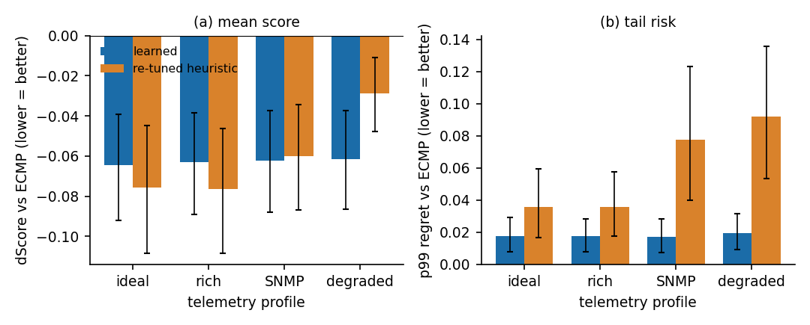
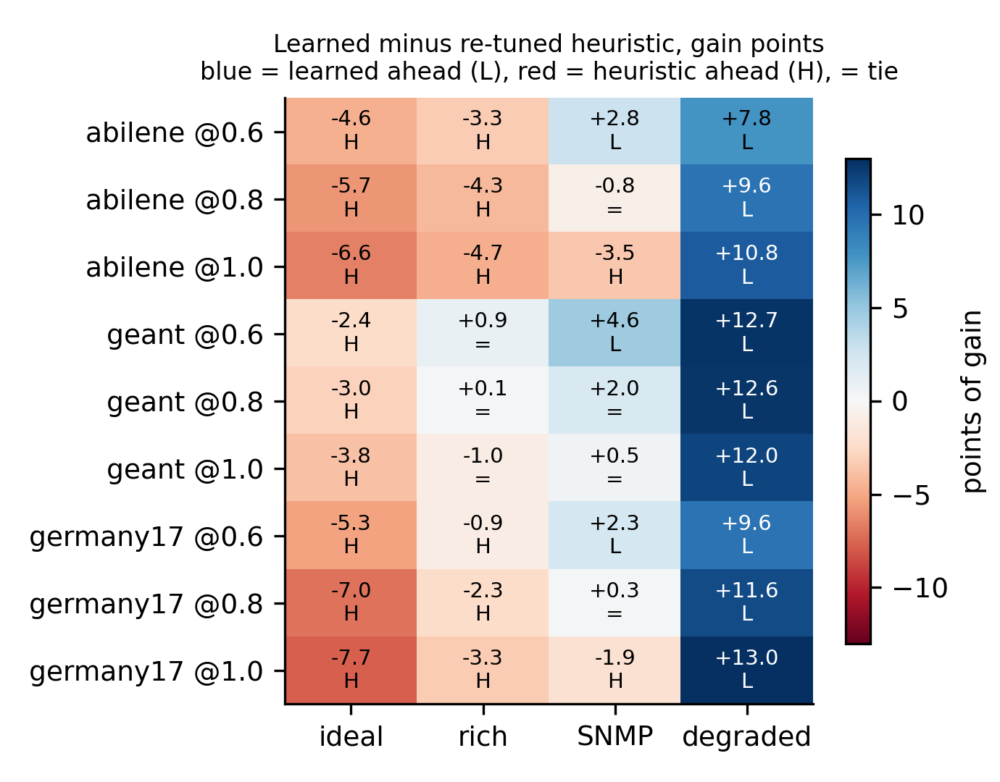
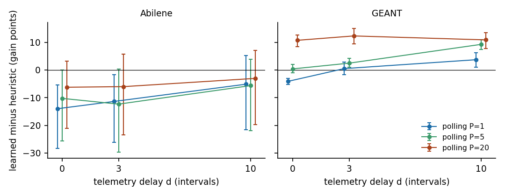

### 6.1 Held-out Topology Zoo graphs (24 graphs)

The heuristic is tuned separately for each telemetry profile. For every profile we run five independent tuner seeds with 80 trials each on the same four synthetic tuning graphs, and evaluate each resulting parameter set on the 24 held-out graphs with the same evaluation seeds as the learned policy. The learned policy is the mean of four training seeds. We report the heuristic averaged over the five tuner seeds, because the best of five is an optimistic estimate; the spread over tuner seeds is given as a range. A "tie" on a graph means the two dScores differ by less than 0.002, about 3% of the learned policy's mean dScore. This threshold is a practical choice, not a derived value. All intervals are percentile bootstrap intervals over graphs (4000 resamples, fixed seed), so they measure graph-to-graph variability and not tuner-seed variability.

**Table 1.** Learned policy versus the re-tuned heuristic on 24 held-out Zoo graphs. dScore is the score change relative to ECMP (lower is better). Differences are heuristic minus learned, so positive values favour the learned policy. W/T/L counts graphs where the learned policy wins, ties and loses. Tail columns use the per-graph p99 regret.

| telemetry | learned dScore | heuristic dScore (range over tuner seeds) | difference [95% CI] | W/T/L | p99 regret learned / heuristic | tail difference [95% CI] | graphs with lower learned p99 |
|---|---|---|---|---|---|---|---|
| ideal | -0.065 | -0.076 (-0.085 to -0.065) | -0.011 [-0.026, +0.002] | 4/11/9 | 0.018 / 0.036 | +0.018 [+0.000, +0.039] | 9 of 24 |
| rich | -0.063 | -0.076 (-0.081 to -0.073) | -0.014 [-0.027, -0.004] | 3/10/11 | 0.018 / 0.036 | +0.018 [+0.004, +0.035] | 10 of 24 |
| SNMP | -0.062 | -0.060 (-0.072 to -0.053) | +0.002 [-0.007, +0.012] | 7/10/7 | 0.017 / 0.077 | +0.060 [+0.027, +0.101] | 13 of 24 |
| degraded | -0.061 | -0.029 (-0.045 to -0.004) | +0.033 [+0.018, +0.049] | 15/9/0 | 0.019 / 0.092 | +0.073 [+0.038, +0.113] | 13 of 24 |

**Figure 1.** Held-out Zoo graphs (24). (a) Mean dScore and (b) mean per-graph p99 regret by telemetry profile for the learned policy (mean of 4 training seeds) and the re-tuned heuristic (mean of 5 tuner seeds). Error bars are 95% bootstrap intervals over graphs.

Table 1 and Fig. 1 give three results.

*Average performance depends on telemetry quality.* With ideal or rich telemetry the re-tuned heuristic is better on average, and the difference excludes zero for rich telemetry. With SNMP-like telemetry the two are tied (7 wins, 10 ties, 7 losses). Under degraded telemetry the learned policy is ahead on average and wins 15 graphs, ties 9 and loses none. Seed-to-seed variation of the learned policy is small (standard deviation 0.001 to 0.002).

*Tail risk is lower for the learned policy on average, but not on every graph.* Its mean p99 regret is lower in every profile, and the interval of the difference excludes zero for rich, SNMP and degraded telemetry (for ideal telemetry the lower end is 0.000). However, the learned policy has the lower p99 on only 9 to 13 of the 24 graphs. The average gap comes from a minority of graphs on which the heuristic has a large tail. We therefore describe the advantage as lower on average, not as a uniform improvement.

*Tuning variation is large.* Under SNMP telemetry the heuristic's dScore ranges from -0.072 to -0.053 across tuner seeds, which is as large as the differences in Table 1. A comparison based on one tuning run can therefore change sign.

The ranking does not depend on the loss weight in the score. At weight 0 (pure maximum utilisation) the heuristic still wins at ideal telemetry (dScore -0.061 against -0.043) and the learned policy wins at degraded telemetry (-0.040 against -0.030). At weight 20 the learned policy wins on 21 of 24 graphs under degraded telemetry, and the heuristic stays ahead under ideal, rich and SNMP telemetry. The heuristic is tuned with weight 5 in all cases.

We also tested four stress scenarios on 12 graphs under SNMP and degraded telemetry: link failures, demand shifts, flash crowds and hotspots (Table 2).

**Table 2.** Stress scenarios on 12 Zoo graphs. dScore and p99 regret as in Table 1; difference is heuristic minus learned with a 95% bootstrap interval over graphs.

| scenario | telemetry | learned dScore | heuristic dScore | difference [95% CI] | learned W/T/L | p99 regret learned / heuristic |
|---|---|---|---|---|---|---|
| link failure | SNMP | -0.066 | -0.070 | -0.004 [-0.018, +0.009] | 3/6/3 | 0.018 / 0.065 |
| link failure | degraded | -0.064 | -0.044 | +0.020 [+0.007, +0.036] | 6/6/0 | 0.019 / 0.081 |
| demand shift | SNMP | -0.059 | -0.047 | +0.011 [+0.001, +0.027] | 4/7/1 | 0.044 / 0.101 |
| demand shift | degraded | -0.057 | -0.021 | +0.035 [+0.015, +0.058] | 7/5/0 | 0.045 / 0.143 |
| flash crowd | SNMP | -0.073 | -0.067 | +0.005 [-0.009, +0.023] | 5/4/3 | 0.022 / 0.078 |
| flash crowd | degraded | -0.069 | -0.036 | +0.032 [+0.012, +0.059] | 7/5/0 | 0.028 / 0.105 |
| hotspot | SNMP | -0.126 | -0.090 | +0.036 [-0.012, +0.105] | 4/2/6 | 0.042 / 0.116 |
| hotspot | degraded | -0.123 | -0.022 | +0.101 [+0.029, +0.204] | 9/3/0 | 0.048 / 0.167 |

Under degraded telemetry the learned policy is ahead in all four scenarios, with intervals that exclude zero. Under SNMP telemetry the intervals include zero except for demand shifts. The learned policy has lower p99 regret in all eight cells, but each cell has only 12 graphs and the caveat about a minority of graphs applies here too. In this table the heuristic is the parameter set with the best tuning score for each profile.

### 6.2 Real traces

We replay SNDlib traces on Abilene, GEANT and Germany17 at three target loads (0.6, 0.8 and 1.0) and four telemetry profiles. Each cell uses 12 random 100-interval windows. For each cell we bootstrap the paired difference in gain (learned minus heuristic) over windows. The heuristic is the parameter set with the best tuning score for each profile (Section 6.1). Windows with zero traffic are skipped.

**Table 3.** Real-trace comparison, 36 cells (3 networks, 3 loads, 4 profiles, 12 windows each). Counts show cells where the paired 95% interval favours the learned policy, includes zero (tie) or favours the heuristic. The last column gives the range of the mean difference in points of gain (positive favours the learned policy).

| telemetry | learned ahead | tie | heuristic ahead | range of mean difference |
|---|---|---|---|---|
| ideal | 0 | 0 | 9 | -7.7 to -2.4 |
| rich | 0 | 3 | 6 | -4.7 to +0.9 |
| SNMP | 3 | 4 | 2 | -3.5 to +4.6 |
| degraded | 9 | 0 | 0 | +7.8 to +13.0 |
| all | 12 | 7 | 17 | |

**Figure 2.** Real traces: learned minus heuristic gain in points, per network, load and telemetry profile. Letters give the verdict of the paired 95% bootstrap interval over windows (L learned ahead, H heuristic ahead, = tie).

The real-trace results agree with the Zoo results. Under ideal telemetry the heuristic is ahead in every cell. Under rich telemetry it is ahead or tied. Under SNMP-like telemetry the result is mixed. Under degraded telemetry the learned policy is ahead in all nine cells, by 7.8 to 13.0 points. On Germany17 the heuristic's gain under degraded telemetry is only 1.5% to 2.8%, while the learned policy gains 12% to 14%. Germany50, a 50-node network larger than any training graph, and the Brain network were evaluated only with a single-run heuristic; see Appendix A. In the Brain network the heaviest 600 demands carry 90% of the traffic, and gains are about 0.3% for every method in most windows, with one rare window in which the learned policy gained 20.9%.

### 6.2a Which impairment drives the ranking?

*Delay and the heuristic's parameters.* We first vary only the telemetry delay d, with everything else ideal, and run the heuristic in three ways: with parameters frozen at the values tuned for clean telemetry, frozen at the values tuned for degraded telemetry, and re-tuned at each delay (one 40-trial run on four synthetic graphs). The learned policy is the mean of four training seeds (Table 4).

**Table 4.** Mean gain (%) over ECMP versus delay d at load 0.8 for the heuristic with frozen and re-tuned parameters and the learned policy. Zoo rows are averages over 10 graphs.

| case | d | heuristic, frozen (clean-tuned) | heuristic, frozen (degraded-tuned) | heuristic, re-tuned at d | learned |
|---|---|---|---|---|---|
| Abilene | 0 | 34.0 | 16.4 | 41.9 | 34.5 |
| Abilene | 3 | 6.4 | 20.7 | 34.7 | 34.2 |
| Abilene | 5 | 0.0 | 22.5 | 23.2 | 34.5 |
| Abilene | 10 | 0.0 | 0.0 | 21.0 | 34.7 |
| GEANT | 0 | 37.6 | 38.2 | 45.6 | 42.6 |
| GEANT | 3 | 1.9 | 31.9 | 43.6 | 42.5 |
| GEANT | 5 | 0.0 | 24.2 | 23.2 | 42.5 |
| GEANT | 10 | 0.0 | 0.0 | 24.9 | 41.8 |
| Zoo | 0 | 4.8 | 0.9 | 5.1 | 4.8 |
| Zoo | 3 | 0.7 | 0.5 | 3.2 | 4.3 |
| Zoo | 5 | 0.0 | 2.2 | 2.3 | 4.3 |
| Zoo | 10 | 0.0 | 0.0 | 2.8 | 4.2 |

A heuristic with frozen parameters collapses to about zero gain at delays of five intervals or more. This mostly reflects mis-tuning: when re-tuned at each delay, the heuristic keeps most of its gain. It matches the learned policy at small delay (at d = 3: Abilene 34.7 against 34.2, GEANT 43.6 against 42.5) and is behind at d = 5 and d = 10. The learned policy's gain does not depend on d. Because a single tuning run is noisy, the comparisons in the rest of this paper use re-tuned heuristics, and the grid below uses repeated tuning.

*Delay and polling period together.* We re-tune the heuristic five times in each (d, P) cell, with independent tuner seeds and 80 trials each, where P is the polling period. The reported heuristic is the seed with the best tuning score, so selection never uses evaluation data. Table 5 shows the learned policy's gain minus the heuristic's, in points.

**Table 5.** Learned minus re-tuned heuristic gain (points) over the delay d and polling period P grid. Positive favours the learned policy. Zoo values average 10 graphs; Abilene and GEANT use the same evaluation windows as Table 4.

| case | d=0 P=1 | d=0 P=5 | d=0 P=20 | d=3 P=1 | d=3 P=5 | d=3 P=20 | d=10 P=1 | d=10 P=5 | d=10 P=20 |
|---|---|---|---|---|---|---|---|---|---|
| Zoo | -0.4 | -0.1 | +0.9 | +1.2 | +1.0 | +1.1 | +1.5 | +1.9 | +0.9 |
| Abilene | -7.2 | -2.9 | +5.4 | -2.7 | -1.8 | +8.5 | +3.5 | +6.3 | +6.2 |
| GEANT | -1.7 | +1.8 | +12.5 | +0.7 | +3.8 | +15.5 | +5.0 | +11.3 | +15.0 |

The heuristic is ahead in 5 of 18 real-trace cells (Abilene with d at most 3 and P at most 5; GEANT at d = 0, P = 1), within one point in two more, and behind in the rest by up to 15.5 points. Even against the best of the five tuner seeds, an oracle on evaluation data that favours the heuristic, the learned policy stays 2.9 to 9.5 points ahead in the cells with P = 20 or d = 10, with one tie. On Zoo graphs the two are within 0.4 points at d = 0 with P at most 5, and the learned policy is ahead by 0.9 to 1.9 points elsewhere. The learned policy's gain varies by less than two points across the grid, while the heuristic's gain falls with both delay and polling period (Abilene: 41.7% at d = 0, P = 1 down to 27.8% at d = 10, P = 20). The spread over tuner seeds inside one cell is up to about 10 points (GEANT at d = 10, P = 1: 24.4 to 36.8), so margins smaller than that should not be over-read. The pattern is a gradient. No delay value flips the ranking independently of the polling period and the network.

*Window-level uncertainty.* Table 6 evaluates the selected heuristic on 16 fresh windows per cell (14 on GEANT after skipping zero-traffic windows), paired with the mean of four learned seeds, with bootstrap intervals over windows (Fig. 3).

**Table 6.** Paired window-level comparison over the delay and polling grid at load 0.8. Gains in %; difference is learned minus heuristic in points with a 95% bootstrap interval over windows. Verdict: L learned ahead, H heuristic ahead, = tie.

| network | d | P | heuristic % | learned % | difference [95% CI] | verdict | windows |
|---|---|---|---|---|---|---|---|
| Abilene | 0 | 1 | 44.9 | 30.9 | -14.0 [-27.8, -5.6] | H | 16 |
| Abilene | 0 | 5 | 40.8 | 30.6 | -10.3 [-25.9, -0.3] | H | 16 |
| Abilene | 0 | 20 | 38.2 | 32.0 | -6.2 [-21.8, +2.9] | = | 16 |
| Abilene | 3 | 1 | 42.6 | 31.2 | -11.4 [-26.8, -1.8] | H | 16 |
| Abilene | 3 | 5 | 40.9 | 28.6 | -12.3 [-29.4, +0.4] | = | 16 |
| Abilene | 3 | 20 | 35.8 | 29.8 | -6.0 [-22.7, +5.8] | = | 16 |
| Abilene | 10 | 1 | 37.0 | 31.8 | -5.1 [-22.4, +5.0] | = | 16 |
| Abilene | 10 | 5 | 37.4 | 31.7 | -5.7 [-21.3, +4.0] | = | 16 |
| Abilene | 10 | 20 | 32.8 | 29.8 | -3.0 [-18.7, +7.0] | = | 16 |
| GEANT | 0 | 1 | 38.5 | 34.4 | -4.1 [-5.2, -3.0] | H | 14 |
| GEANT | 0 | 5 | 33.9 | 34.2 | +0.4 [-1.1, +1.9] | = | 14 |
| GEANT | 0 | 20 | 22.2 | 32.9 | +10.7 [+8.3, +12.8] | L | 14 |
| GEANT | 3 | 1 | 33.8 | 34.3 | +0.5 [-1.6, +2.9] | = | 14 |
| GEANT | 3 | 5 | 31.7 | 34.2 | +2.5 [+1.0, +4.2] | L | 14 |
| GEANT | 3 | 20 | 20.4 | 32.7 | +12.3 [+9.3, +15.0] | L | 14 |
| GEANT | 10 | 1 | 29.5 | 33.2 | +3.7 [+1.1, +6.4] | L | 14 |
| GEANT | 10 | 5 | 23.6 | 32.9 | +9.2 [+7.3, +10.9] | L | 14 |
| GEANT | 10 | 20 | 20.5 | 31.4 | +10.9 [+7.9, +13.5] | L | 14 |

**Figure 3.** Delay and polling grid with the re-tuned heuristic: learned minus heuristic gain in points on fresh windows, with 95% bootstrap intervals over windows.

On GEANT the pattern is clear. The heuristic is ahead only at d = 0, P = 1 (-4.1 [-5.2, -3.0]), two cells are ties, and the learned policy is ahead in the other six, by 2.5 to 12.3 points. Its advantage grows with delay and polling period. On Abilene the result is not resolved. The heuristic's point estimate is ahead in all nine cells, by 3.0 to 14.0 points. The interval excludes zero in three cells (heuristic ahead) and includes zero in six, and the interval half-widths are 10 to 15 points. The tuner saw only synthetic graphs and never a real trace or evaluation window.

*Why Abilene is unresolved.* The Abilene results depend on which windows are drawn and on how the heuristic is tuned. We evaluated two window samples (A: 12 windows, B: 16 windows) with two heuristic parameter sets (the per-profile set and the grid-selected set) under the same telemetry (Table 7). Both experiments use the same model checkpoints, trace loader, scaling, gain definition and 100-interval windows chosen by seed.

**Table 7.** Abilene at load 0.8 under the same telemetry: two window samples and two heuristic parameter sets. Difference is learned minus heuristic in points with a 95% bootstrap interval over windows.

| telemetry | window set | heuristic parameters | heuristic % | learned % | difference [95% CI] |
|---|---|---|---|---|---|
| SNMP | A | per-profile | 27.9 | 36.3 | +8.4 [+4.2, +12.3] |
| SNMP | A | grid-selected | 17.7 | 36.3 | +18.6 [+5.7, +32.0] |
| SNMP | B | per-profile | 32.7 | 31.4 | -1.3 [-18.5, +9.9] |
| SNMP | B | grid-selected | 29.3 | 31.4 | +2.1 [-16.0, +15.0] |
| degraded | A | per-profile | 17.0 | 36.1 | +19.1 [+9.0, +30.2] |
| degraded | A | grid-selected | 31.2 | 36.1 | +4.9 [+1.3, +9.0] |
| degraded | B | per-profile | 24.2 | 28.6 | +4.5 [-14.3, +19.0] |
| degraded | B | grid-selected | 35.5 | 28.6 | -6.8 [-23.6, +5.6] |
| clean, d=3, P=5 | A | grid-selected | 37.0 | 36.6 | -0.4 [-2.5, +1.8] |
| clean, d=3, P=5 | B | grid-selected | 40.9 | 28.6 | -12.3 [-31.9, +0.3] |

The window sample matters most. With identical policies and telemetry (clean, d = 3, P = 5) the learned policy is level with the heuristic on set A and 12.3 points behind on set B, and the learned policy's own gain moves from 36% to 29%. Heuristic parameters also matter: under degraded telemetry on set A the grid-selected parameters reach 31.2% against 17.0% for the per-profile parameters. We found no implementation inconsistency, and we cannot attribute the remaining difference beyond these two sources. Conclusions for Abilene are therefore limited to the statement that the sign depends on the window sample and on the heuristic's tuning.

